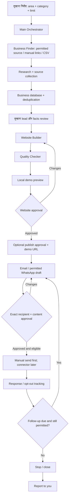

# Freshy AI — Local AI Web Agency Blueprint

यह planning document है; अभी working agent या live messaging integration नहीं बनी है।

## 1. हमारा लक्ष्य

तुम शहर/इलाका और business category चुनोगे। System अनुमति-प्राप्त sources या तुम्हारे दिए links/CSV से business leads लेगा, facts के sources रखेगा, चुने हुए businesses की demo websites बनाएगा और review के लिए दिखाएगा। तुम्हारी अलग-अलग approvals के बाद ही demo publish या outreach send हो सकेगा।

**तुम्हारे decisions:** Desktop • Zero budget • Hindi + English • HTML/CSS/JS और React दोनों website outputs • सभी business categories.

**शुरुआती सीमा:** एक शहर, एक category, 3 businesses, पहले सिर्फ एक पूरी demo. सभी categories support करना long-term goal है, लेकिन हर category के लिए पहले दिन अलग template नहीं बनाएँगे।

यह local desktop workflow होगा: तुम्हारे computer पर Python server और browser में dashboard. यह शुरुआत में native .exe application नहीं होगा। Computer बंद होने पर jobs और follow-ups नहीं चलेंगे।

## 2. क्या संभव है और कहाँ सीमा है?

| जरूरत | पहला zero-budget तरीका | बाद में automation |
|---|---|---|
| Nearby businesses खोजना | City/area manually enter; search करके चुने हुए public links या CSV import | अनुमति देने वाला search/maps provider; terms, quotas और billing जाँचना |
| Google Maps से details | तुम manually verified facts enter/import करो, source URL के साथ | Official licensed API, केवल उसकी permitted storage/use शर्तों के अनुसार |
| Research | Official business pages की छोटी, user-triggered fetch; unsupported pages manual | Rate-limited source adapters; site rules और access restrictions का पालन |
| Website बनाना | Local templates + verified business facts | Optional local language model; hardware पर्याप्त होना चाहिए |
| AI writing | Manual editable copy और deterministic templates | Optional Ollama/local model; model license और hardware जाँचेंगे |
| Email | Verified public business email के लिए draft, फिर manual send | Configured email provider; quotas, authentication और sending policy लागू |
| WhatsApp | केवल business द्वारा प्रकाशित WhatsApp link या अनुमति-प्राप्त contact; reviewed draft | Official WhatsApp Business Platform, opt-in और applicable template rules के साथ |
| Hosting | Local preview; ZIP export | चुने हुए hosting provider का free tier, उसकी मौजूदा terms/limits के अधीन |

**Zero budget का अर्थ:** Core app के लिए mandatory paid API, domain या subscription नहीं। Computer, electricity, internet और पर्याप्त storage तुम्हारे पास होने चाहिए। AI model download और local inference भी resources लेते हैं। Cloud hosting, domains, email delivery, business messaging और maps APIs को हमेशा free नहीं मानेंगे।

### जरूरी boundaries

- Google search results/Maps की unrestricted bulk scraping, CAPTCHA bypass या private data collection नहीं करेंगे।
- Public phone number होना WhatsApp opt-in नहीं है। नंबरों पर registration probing या bulk WhatsApp account checks नहीं होंगे।
- Google Maps listing को unrestricted data-export license नहीं मानेंगे। हर source की permitted use/storage शर्तें लागू होंगी।
- Outreach के लिए public business contact ही लें; personal/private contacts, purchased contact dumps और guessed email addresses नहीं।
- Email public होने से marketing की blanket permission नहीं मिलती। Applicable law, provider rules, opt-out और relevance जाँचने के बाद ही outreach करें।
- AI को clinic का doctor, treatment outcome, license, price, opening hours या customer review invent नहीं करने देंगे।
- Generated demo को उस business की official website या endorsement की तरह प्रस्तुत नहीं करेंगे।

## 3. Updated workflow



**Website approval, public publishing approval और message approval अलग हैं।** Website approve करने से message send करने की permission नहीं मिलती। Follow-up भी नया message है, जिसकी review/approval होगी।

## 4. Architecture: पहले simple, बाद में intelligent

शुरुआत में सात अलग autonomous AI bots नहीं बनाएँगे। एक orchestrator और छोटे testable modules बनाएँगे। हर module के input/output तय होंगे; बाद में जरूरत के हिसाब से AI जोड़ा जा सकेगा।

### Proposed local stack

- **Backend:** Python 3.11+; पहला runnable milestone standard library से, बाद में जरूरत हो तो FastAPI.
- **Database:** SQLite — local file, अलग database service की जरूरत नहीं।
- **Dashboard:** HTML/CSS/JavaScript; Hindi और English labels/content.
- **Website output 1:** Plain HTML/CSS/JS, बिना Node build के खुलने और export होने वाला।
- **Website output 2:** React/Vite project export; इस phase पर Node.js LTS चाहिए।
- **Optional AI:** Local model adapter; AI unavailable हो तो template workflow चलता रहे।
- **Tests:** Python unittest से शुरू; frontend/build checks अगले phases में।
- **Distribution:** पहले local browser dashboard; desktop packaging बाद में, अगर जरूरी हो।

Local install default में सिर्फ `127.0.0.1` पर bind होगा। Arena जैसे hosted development preview में `0.0.0.0` और preview-safe configuration चाहिए। Secrets या dashboard को बिना authentication internet पर expose नहीं करेंगे।

### Proposed structure (अभी planned, implemented नहीं)

```text
app/
  server.py
  database.py
  orchestrator.py
  modules/
    discovery.py
    research.py
    websites.py
    quality.py
    outreach.py
    followups.py
  templates/
    static/
    react/
  dashboard/
    index.html
    app.js
    styles.css
  locales/
    hi.json
    en.json
tests/
data/                 # local SQLite; Git से excluded
outputs/              # generated demos/ZIP; Git से excluded
.env                  # optional secrets; Git से excluded
.env.example          # names only, कभी real keys नहीं
docs/
```

## 5. Modules और उनका काम

### A. Main Orchestrator

Campaign instructions रखे: area, category, maximum leads, language, website output. Queue से एक काम उठाए। Pause/resume हो, error report दिखे और bounded retries हों। Unknown error पर बार-बार messages send न करे।

### B. Business Finder

MVP में CSV/manual entry: business name, category, locality, official website/listing link. Duplicate को normalized name+address, source ID या verified contact से flag करे; ambiguous records review में जाएँ। Automatic merge से बचें।

बाद में permitted provider adapter जोड़ें। Home address जरूरी नहीं: locality/city और radius पर्याप्त हो सकते हैं। Requested radius और provider support के बिना exact distance का दावा न करें।

### C. Research

Business facts के साथ source URL, collection time, verification state और confidence रखे। Email न मिले तो `unknown`; guess नहीं। Public WhatsApp link न मिले तो `not verified`; arbitrary phone number को WhatsApp मानकर convert नहीं करें।

Research में third-party webpages **untrusted data** हैं। Page में लिखे instructions tools/approval को override नहीं कर सकते। Fetcher में localhost/private-network blocking, redirect revalidation, timeout और size limits होंगे ताकि arbitrary URLs से local services expose न हों। Website output में imported text escape/sanitize होगा।

### D. Business Database

Facts, drafts, approvals, consent evidence, sends और activity log अलग रखें। One-click backup/export और deletion दें। Rejected leads के unnecessary personal data को हटाने का तरीका रखें; opt-out suppression के लिए न्यूनतम जरूरी record रखें।

### E. Website Builder

पहले business-agnostic template: hero, verified services, about, hours/address if known, contact. फिर dental/clinic, jewellery, salon, restaurant और अन्य layouts.

- Hindi, English या bilingual content चुन सकें।
- HTML और React दोनों target; MVP में HTML पहले।
- Unknown facts छोड़ें या review में flag करें; fake facts से खाली जगह न भरें।
- Logo/photos केवल supplied या licensed assets; internet से मिली हर image copy नहीं करेंगे।
- Demo पर “Unofficial concept demo — not affiliated with this business” स्पष्ट रखें।
- Clinic demos पर medical claims/testimonials invent नहीं होंगे; business approval के बिना appointment/payment collection नहीं।
- Concept contact form disabled/clearly labelled होगा; real customer data collect नहीं करेगा।

### F. Quality Checker

Automated checks: required structure, missing placeholders, broken local assets, correct contact links, no horizontal overflow at chosen viewport checks, basic accessibility checks और build validity. Human review: copy की accuracy, appearance, license/brand issues और business fit.

Automated pass से factual correctness, legal compliance, search ranking या complete accessibility guarantee नहीं मिलती। Public concept demo में `noindex` और sitemap exclusion रखें; `noindex` privacy/security नहीं है। Sensitive/unapproved demos local या access-controlled रखें।

### G. Outreach + Follow-up

Draft में तुम्हारा सही परिचय, relevant short proposal, clearly labelled unofficial concept demo और simple opt-out हो। “हम आपकी agency हैं” जैसे झूठे affiliation claims नहीं। Open tracking pixels नहीं जोड़ेंगे।

पहले email draft export/manual send. Published demo URL absent हो तो local file link recipient को न भेजें; पहले approved hosting या उचित attachment का review करें। Live connector आने पर exact recipient/body/attachments का snapshot approve होगा। Content बदलते ही पुरानी approval invalid होगी।

Follow-up example policy: default off; अगर enable करो तो 5–7 दिन बाद अधिकतम एक draft, केवल no reply/no opt-out और channel की permission rules allow करने पर। यह internal limit है, कानून/provider की अनुमति का विकल्प नहीं।

## 6. Database blueprint

| Table | मुख्य fields |
|---|---|
| campaigns | id, area, category, language, output_type, max_leads, status |
| businesses | id, name, category, address, official_url, normalized_identity, review_status |
| campaign_businesses | campaign_id, business_id, stage, selected_at |
| sources | id, business_id, url, retrieved_at, permitted_use_notes |
| facts | id, business_id, field_name, value, source_id, verified_at, verification_status |
| contacts | id, business_id, channel, value, source_id, verification_status |
| permissions | id, contact_id, channel, scope, evidence, recorded_at, revoked_at |
| websites | id, business_id, version, output_type, content_hash, local_path, public_url, status |
| qa_results | id, website_id, check_name, outcome, details, checked_at |
| messages | id, business_id, contact_id, channel, purpose, subject, body, content_hash, status |
| approvals | id, entity_type, entity_id, content_hash, approved_by, approved_at, revoked_at |
| send_attempts | id, message_id, idempotency_key, provider_id, status, attempted_at, error |
| suppressions | id, normalized_contact, channel, reason, created_at |
| tasks | id, campaign_id, task_type, status, attempt_count, due_at, last_error |
| audit_events | id, entity_type, entity_id, action, actor, created_at, safe_metadata |

Business एक से ज्यादा campaigns में आ सकता है। Duplicate outreach रोकने के लिए contact history सभी campaigns में जाँची जाएगी। Logs में credentials और unnecessary message contents नहीं लिखेंगे।

### State rules

- Lead: `new → researched → review_required → verified / rejected`.
- Website: `draft → qa_failed / review_required → approved → publish_review → published`.
- Message: `draft → review_required → approved → sending → sent / failed / delivery_unknown`.
- किसी समय `suppressed / cancelled` हो तो send/follow-up block.
- Website/message edit पर नया version और reapproval जरूरी।
- Network timeout के बाद `delivery_unknown` को blindly retry नहीं करेंगे; provider state/manual reconciliation जरूरी।
- Send से ठीक पहले approval hash, recipient, permissions, suppression और idempotency check दोबारा होगा।

## 7. Dashboard screens

1. **Overview:** leads, demos needing review, messages awaiting approval, errors.
2. **New Campaign:** city/area, category, language, HTML/React, lead cap.
3. **Leads:** import, filters, duplicate warnings, verified/unverified status.
4. **Research Detail:** field के सामने source, edit और verify controls.
5. **Website Studio:** template, preview, QA, changes, approve, export.
6. **Outreach Review:** exact recipient, draft, consent/policy checklist, approve/reject.
7. **Activity:** jobs, failures, manual sent confirmation, opt-outs, follow-up drafts.
8. **Settings:** language, local model, adapters, backups; secrets masked.

“Approve all and message everyone” जैसा default shortcut नहीं होगा। पहले release में bulk sending नहीं।

## 8. Build roadmap और completion checks

| Phase | क्या बनाएँगे | तभी complete मानेंगे जब |
|---|---|---|
| 0. Setup | OS/tool checks, project folders, safe ignores | Python चलता है; workspace writable; कोई key नहीं चाहिए |
| 1. Local dashboard | Server, bilingual shell, SQLite | Browser में खुलता है और restart पर saved record रहता है |
| 2. Leads | Manual form + CSV import/export + source fields | तीन test leads; duplicate/invalid CSV correctly handled |
| 3. Research | Facts editor, source references, review states | Missing email invent नहीं होता; verified/unverified साफ दिखता है |
| 4. HTML demo | एक reusable responsive template + local preview/export | एक demo बने; sources match; placeholders/QA handled |
| 5. Approvals | Website/message versioning + audit trail | Edit से approval invalid; unapproved action blocked |
| 6. Outreach drafts | Hindi/English email drafts, manual-send flow, suppression | बिना real message भेजे full review cycle और opt-out test pass |
| 7. Research automation | एक permitted provider adapter | Quotas, failure handling और source terms reviewed |
| 8. Optional local AI | Copy/research assistance via adapter | No-model fallback; generated facts मानव review में जाएँ |
| 9. React export | React template + build/export | Node setup के बाद generated project builds successfully |
| 10. Live channels | Optional email/WhatsApp official adapters | Accounts/permissions/costs reviewed; approved test recipient only |
| 11. Follow-ups | Persistent scheduled drafts + report | Restart recovery; reply/opt-out cancels task; reapproval enforced |

Calendar deadline अभी नहीं: computer specs, OS और रोज कितना समय दोगे, यह जानने के बाद estimate देंगे। हर phase के बाद तुम खुद उसका छोटा test करोगे।

## 9. पहला end-to-end trial

**Safe demo:** “Sample Dental Studio” नाम का स्पष्ट fictional test record. Real clinic का नाम/facts तभी लें जब sources और contact-use review हो।

1. एक local test campaign बनाओ।
2. तीन fictional leads add करो, real contact fields खाली रखो।
3. एक lead के verified sample facts से HTML demo बनाओ।
4. QA में missing email correctly दिखना चाहिए।
5. Website approve करो, फिर edit करके देखो कि approval reset हुआ या नहीं।
6. एक outreach draft बनाओ; recipient खाली हो तो send blocked रहे।
7. Test opt-out record डालो और confirm करो कि अगला draft/send blocked होता है।
8. ZIP export और database backup restore test करो।

इसके बाद ही एक real, manually reviewed business पर trial करेंगे। Lead discovery, demo generation, outreach और sales अलग stages हैं; demo बनने का मतलब customer मिलना या business की approval नहीं है।

## 10. अभी तुम्हारा पहला कदम

[STEP_01_SETUP.md](STEP_01_SETUP.md) खोलो। अभी कोई paid account, API key, WhatsApp login या SMTP password नहीं चाहिए। अपना OS और hardware बताओ, फिर उसी के अनुसार exact setup और पहला runnable milestone साथ में बनाएँगे।
